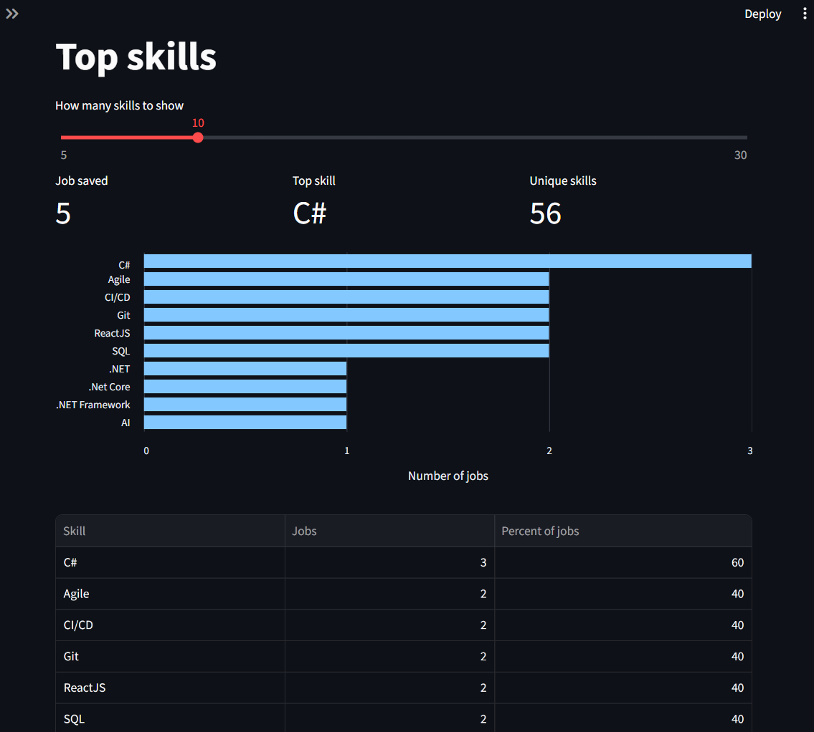
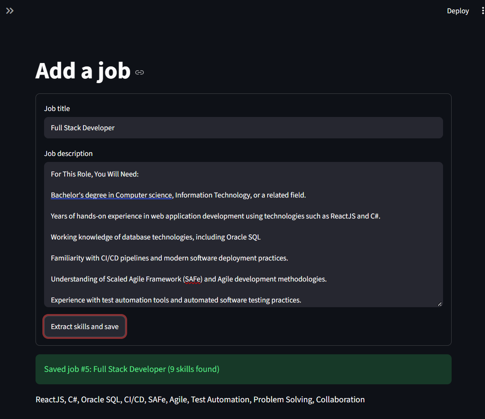

# Job Skill Tracker

An AI-powered tool that extracts skills from job postings and shows which skills employers ask for most, with a web dashboard and a command-line version.

I built this during my own job search to find out which skills employers are actually asking for, so I know what to focus on learning.



## Features

- Paste in any job posting and save it to a local database
- AI automatically extracts the skills (languages, frameworks, tools, soft skills)
- Interactive bar chart of the most requested skills, with an adjustable number of skills shown
- Summary cards for jobs saved, the top skill, and unique skills found
- Browse saved jobs and view the skills for any single job
- Handles busy or unavailable AI models with automatic retries and fallbacks
- Two interfaces sharing the same database: a Streamlit web app and a command-line app



## Tech Stack

- **Python 3**
- **Streamlit** for the web interface
- **pandas** and **Altair** for data processing and charts
- **SQLite** for storage
- **Google Gemini API** (`google-genai` SDK) for skill extraction
- **python-dotenv** for managing the API key

## How It Works

```
              Job posting text
                     |
        +------------+------------+
        |                         |
     app.py                    main.py
  (web interface)          (command line)
        |                         |
        +------------+------------+
                     |
           +---------+---------+
           |                   |
         ai.py            database.py
           |                   |
      Gemini API      SQLite (jobs + skills)
```

The code is split so each file has one job:

- `app.py` is the Streamlit web interface
- `main.py` is the command-line interface
- `ai.py` handles everything related to the AI provider
- `database.py` handles all database queries

Both interfaces call the same functions in `ai.py` and `database.py`. The web interface was added later without changing either of those files.

## Setup

1. Clone the repository:

   ```
   git clone https://github.com/nadia164/job-skill-tracker.git
   cd job-skill-tracker
   ```

2. Create and activate a virtual environment:

   ```
   python -m venv venv
   venv\Scripts\activate        # Windows
   source venv/bin/activate     # Mac/Linux
   ```

3. Install the dependencies:

   ```
   pip install -r requirements.txt
   ```

4. Get a free API key from [Google AI Studio](https://aistudio.google.com/), then copy `.env.example` to a new file named `.env` and add your key.

5. Run the web app:

   ```
   streamlit run app.py
   ```

   Or the command-line version:

   ```
   python main.py
   ```

## Design Decisions

- **Separate AI and database modules:** All AI code lives in `ai.py` behind one function, `extract_skills()`, and all SQL lives in `database.py`. This made it possible to add the web interface without touching either file, and switching to another AI provider (like Claude or OpenAI) only means replacing `ai.py`.
- **Retries and fallbacks:** If a model is busy (HTTP 503), the app waits and retries once, then falls back to another model. Requests also have a timeout, so the app never hangs.
- **Structured AI output:** The model is asked to return JSON only, and the result is cleaned to remove blanks and duplicates. Postings where no skills are found are not saved.
- **Atomic saves:** A job and its skills are saved in a single transaction. If anything fails, the whole save is rolled back, so there's never half-saved data.
- **Safe SQL:** All queries use parameterized placeholders (`?`) to prevent SQL injection.
- **Case-insensitive grouping:** Skills are grouped with `LOWER()`, so "Python" and "python" count as the same skill.

## Versions

- **v1.0:** Command-line version
- **v2.0:** Added the Streamlit web interface with charts

## Future Improvements

- Filter top skills by job title or date
- Compare my own skills against the most requested ones
- Import postings from a URL
- Deploy the web app online